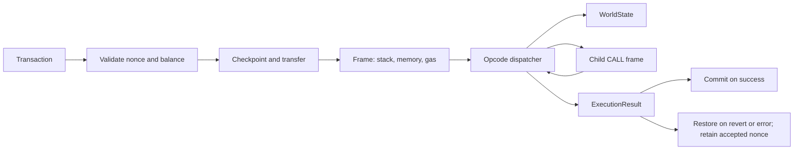

# MiniEVM

A compact Rust project for learning how an EVM execution engine works, one tested change
at a time. Follow a transaction through frames, opcode dispatch, gas accounting, state
changes, and rollback.

## Quick Start

Install Rust through rustup. The repository selects **Rust 1.97.1**, Edition 2024,
with rustfmt and Clippy. There are no third-party Cargo dependencies.

```bash
git clone https://github.com/AstraeusZhao/MiniEVM
cd MiniEVM
cargo test --locked
cargo run --locked --example counter
cargo run --locked --example trace
```

The counter example submits two transactions and prints:

```text
counter = 0
nonce=0, counter=1, gas_used=160
nonce=1, counter=2, gas_used=160
```

The trace example shows the stack, PC, opcode, and gas before each instruction,
then returns the byte `2a` using `PUSH0` and `MSTORE8`.

## Execution Flow



## What You Can Explore

| Area | Current implementation |
| --- | --- |
| Words and stack | Self-contained 256-bit arithmetic including MOD/GT, 1,024-word stack, PUSH0/PUSH/DUP/SWAP |
| Memory | Bounded linear memory, MLOAD/MSTORE/MSTORE8, checked expansion and copying |
| State | Deterministic accounts and storage, value transfers, nested rollback, committed logs |
| Gas | Base prices, memory/copy/log charges, CALL forwarding and settlement |
| Execution | Control flow, calldata, return data, block environment, CALL, RETURN and REVERT |
| Diagnostics | Concrete errors, shared opcode metadata, unlimited or bounded tracing |

See the [architecture](docs/architecture.md) and [opcode reference](docs/opcodes.md)
for the module map, operand ordering, prices, and boundary rules.

## Example

```rust
use minievm::{Address, Evm, ExitReason, Transaction, Word, WorldState};

let caller = Address::from_last_byte(1);
let contract = Address::from_last_byte(2);
let mut state = WorldState::default();
// PUSH1 42, PUSH0, SSTORE, STOP: storage[0] = 42.
state.set_code(contract, vec![0x60, 42, 0x5f, 0x55, 0x00]);
let mut evm = Evm::new(state);
let result = evm.transact(Transaction {
    caller, target: contract, value: 0, input: vec![], gas_limit: 1_000, nonce: 0,
});
assert_eq!(result.reason, ExitReason::Succeed);
assert_eq!(evm.state.account(contract).unwrap().storage[&Word::ZERO], Word::from_u64(42));
```

For failures, inspect `result.error`, which retains the specific `VmError`.
REVERT has its own exit reason and returns bytes in `result.output`.
The crate documentation contains a compiled version of this example.

## Scope and Incremental Development

Balances use `u64`; gas and transaction rules are simplified and independent of Ethereum
forks. Runtime defaults are 64 active frames and 16 MiB of memory per frame. MiniEVM is
not a fork-compatible client and must not be used for real fees or asset settlement.

The [工程计划 / engineering plan](docs/engineering-plan.md) records completed work and
future candidates. Each iteration adds a small, testable capability. More instructions,
hashing, call variants, creation, and tooling can be explored as the project grows.
RPC, persistence, signing, state tries, and a frontend are optional future directions.

Public APIs may change throughout `0.x`. This iteration adds `ExecutionResult::error`
and `VmError::NonceOverflow`; code constructing receipts or exhaustively matching errors
must account for these changes. The unused legacy `VmError::Reverted` variant is removed;
transaction callers should check `ExitReason::Revert` and `ExecutionResult::output`.

## Development

```bash
cargo fmt --check
cargo clippy --all-targets --locked -- -D warnings
cargo test --locked
cargo doc --no-deps --locked
```

GitHub Actions runs formatting, Clippy, tests and documentation on push and pull requests.
These checks are an engineering quality gate; see the [scan scope](docs/security-scan-scope.md).

Start with [CONTRIBUTING.md](CONTRIBUTING.md), the [development guide](docs/development.md),
and the [documentation index](docs/README.md). Historical records live in `docs/records/`.
See the [Code of Conduct](docs/code-of-conduct.md) and [Security Policy](docs/security.md).
Licensed under [LGPL-3.0-only](LICENSE).
