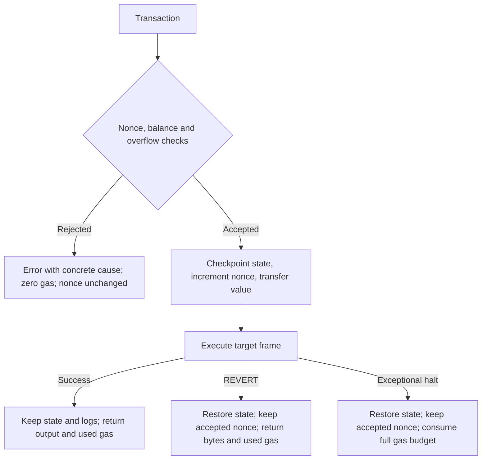

# Architecture

MiniEVM follows `Transaction → Evm::transact → Frame → opcode dispatcher → ExecutionResult`.
The interpreter is synchronous and deterministic; all persistent state is held in memory.

## Module Map

| Path | Responsibility |
| --- | --- |
| `src/core/` | Transaction, block metadata, completion category and receipt |
| `src/primitives/` | 20-byte Address and 256-bit Word |
| `src/state/` | BTreeMap accounts/storage, code, balances and transaction logs |
| `src/memory/` | Bounded, word-aligned byte memory |
| `src/gas/` | Gas budget and shared metadata pricing |
| `src/opcode/` | Instruction metadata: names, prices, stack effects, immediates |
| `src/trace/` | Pre-instruction observation and VecTracer |
| `src/vm/engine.rs` | Transaction validation and frame execution loop |
| `src/vm/frame.rs` | PC, stack, memory, calldata, context and return data |
| `src/vm/bytecode.rs` | JUMPDEST analysis excluding PUSH immediate bytes |
| `src/vm/instructions/mod.rs` | Dispatch, arithmetic, environment, storage and control flow |
| `src/vm/instructions/memory.rs` | Range conversion, copying and dynamic memory gas |
| `src/vm/instructions/call.rs` | CALL preconditions, transfer, child gas and rollback |
| `src/vm/instructions/log.rs` | Log operands, data and topic charges |
| `src/vm/instructions/stack.rs` | Fixed-buffer PUSH decoding and truncation tests |

## Transaction Boundary

The current transaction log buffer is cleared before validation. Validation reads the
sender's nonce and balance without cloning its code or storage. A checkpoint is made only
after validation succeeds. Checkpoints currently clone the full WorldState.

`ExecutionResult::error` is `Some(VmError)` for validation and exceptional failures.
Success and REVERT use `None`; REVERT output remains in `output`. Errors implement
`Display` and `std::error::Error`. Child failures are reflected in CALL's stack result;
they do not become the top-level receipt error when the parent succeeds.

## Frame and CALL Lifecycle

Each frame owns its stack, memory, calldata, PC and return-data buffer. The stack contains
at most 1,024 words. Default limits allow 64 active frames (depths 0 through 63) and
16 MiB of memory per frame. CALL uses host recursion; very large configured depth limits
can exhaust the host stack. The limits are per frame, not an aggregate resource budget.

CALL first checks memory ranges and charges expansion. Depth, insufficient balance,
unrepresentable value, or recipient `u64` balance overflow reject the call locally:
return data is cleared, zero is pushed, and no child gas is spent. Memory/base charges
still apply. A self-call does not change the account balance.

An accepted CALL reserves up to `remaining - remaining / 64` gas and checkpoints state.
Success keeps child changes and refunds unused gas. REVERT restores child state and logs,
returns revert bytes and refunds unused gas. An exceptional child restores state and
consumes the reserved child budget. The parent can continue after either failure.

## Memory and Bytecode Boundaries

Memory grows in 32-byte words. Zero-size operations ignore the memory offset, even when
it cannot fit a host index. RETURNDATACOPY still validates its source range at size zero.
Nonempty unaddressable ranges fail. CALL only overwrites output bytes actually returned.

Word uses four limbs in least-significant-first order; byte conversions are big-endian.
PUSH data missing at the end of code is padded with zero bytes on the right. PUSH0 has no
immediate bytes. Only executable JUMPDEST positions are valid jump targets.

## Tracing and Future Work

`transact_with_tracer` emits frame identity, PC, opcode, gas and stack before base gas is
charged. VecTracer owns stack snapshots and accumulates them without a record limit;
it is intended for small examples and tests. LimitedTracer records a bounded prefix,
marks truncation, and skips stack snapshot construction after its limit. The default
Tracer::capture_next hook preserves existing tracer implementations. Reusing a
LimitedTracer keeps its accumulated prefix and limit across transactions.

The [engineering plan](engineering-plan.md) tracks measured optimization candidates,
including state journals and cached bytecode analysis. Bounded tracing and shared opcode
metadata are now implemented. These are future iterations rather than current implementation claims.
